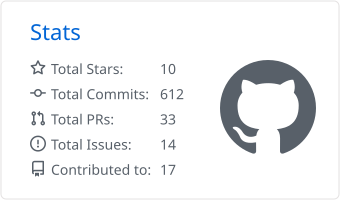
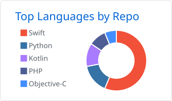

# Hi, I'm Albert

I'm a software engineer transitioning into **AI infrastructure and ML platform engineering**. I'm learning and building production-grade infrastructure for AI/ML workloads; much of my work lives in private repositories.

  Meet my koi: it keeps swimming while you're here and grows with my GitHub activity. 🐟 
  

## Selected work

- [**Doc Helper AI Agent**](https://github.com/etonealbert/doc-helper-ai-agent) — a FastAPI and LangGraph backend with RAG, mock CRM workflows, safety routing, and tests.
- [**Auratio AI Notes**](https://github.com/etonealbert/auratio-ai-notes) — real-time speech-to-text with summarization, translation, and tone control.
- [**Etone Media Engine**](https://github.com/etonealbert/etone-media-engine) — a Python-based media asset manager and Telegram workflow for AI video production, with a mock agent pipeline.

## GitHub snapshot

  <picture>
    <source srcset="cards/stats-dark.svg" media="(prefers-color-scheme: dark)" />
    
  </picture>
  <picture>
    <source srcset="cards/languages-dark.svg" media="(prefers-color-scheme: dark)" />
    
  </picture>

Cards summarize public GitHub activity and update daily. The koi is generated from public activity too.

## Find me elsewhere

[LeetCode](https://leetcode.com/etonealbert) · [Codewars](https://www.codewars.com/users/etonealbert) · [X](https://x.com/etonealbert)
